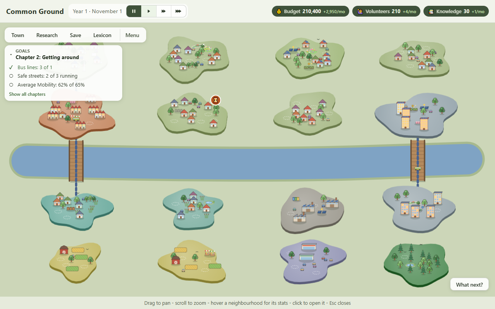
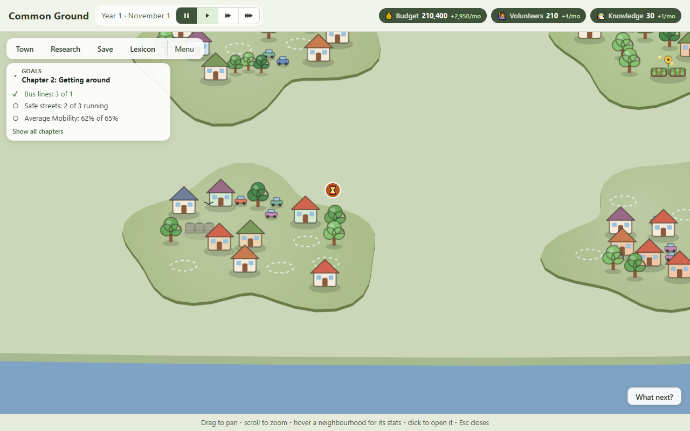
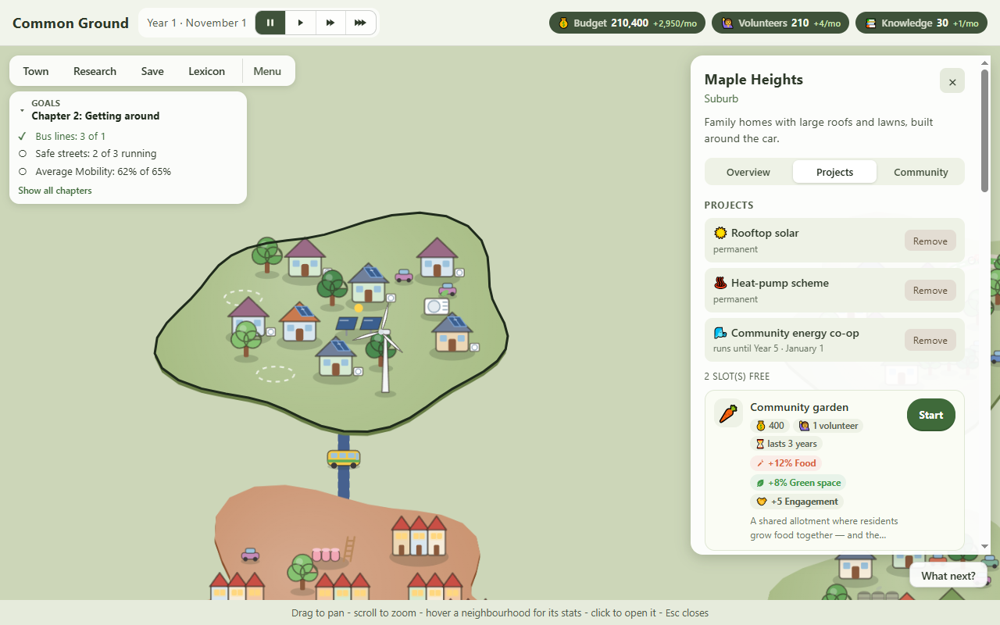
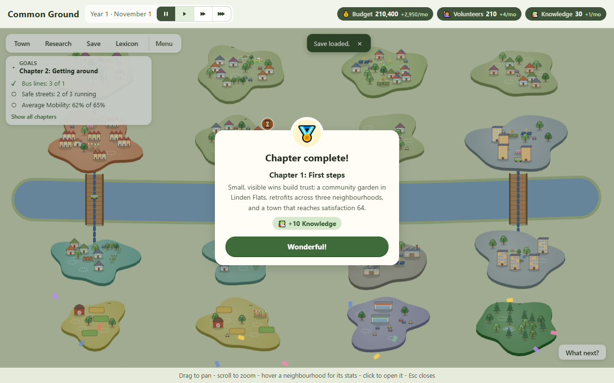
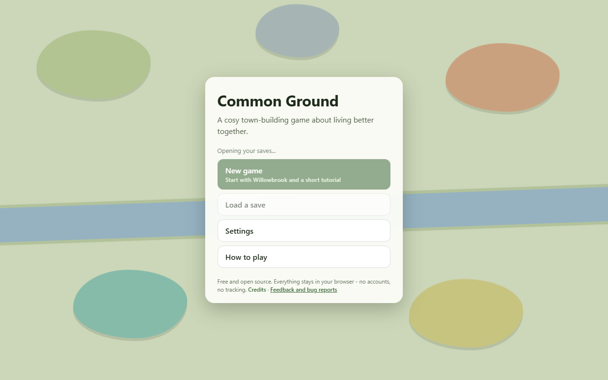
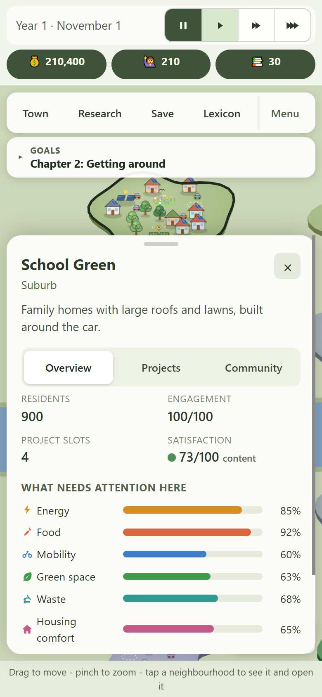

# Common Ground

A cosy, open-source town game about living better together. You are
Willowbrook's community organiser: start gardens and solar roofs, safe streets
and repair cafés, hold town meetings, link neighbourhoods with buses, and watch
sixteen little districts grow greener, livelier and happier.

> **Everything stays in your browser.** Saves live in your own IndexedDB. We
> collect no data; there are no accounts, no analytics and no trackers.



| | |
| --- | --- |
|  |  |
|  |  |



## What's in it

- **16 hand-made neighbourhoods**, drawn in code as soft 2.5D islands with
  their own houses, blocks, farms and woods. **Progress is visible:** solar
  panels appear on roofs, retrofitted homes glow warm, gardens and meadows
  bloom, cars thin out as streets get safer, chimney smoke fades as energy gets
  cleaner, and birds come back to green districts.
- **15 projects and 16 real-world technologies**, each with an honest "limits"
  line and a confidence tag. Volunteer-run projects last a few years and need
  renewing; infrastructure is permanent.
- **Real choices**: everything you build has monthly upkeep, taxes rise and fall
  with how happy the town is, volunteers drift away if they sit idle, and
  deeper research costs more, so money, volunteers and Knowledge all matter.
- **Five chapters** with an always-visible goal tracker, a gentle tutorial, a
  "What next?" helper and an in-game **Lexicon** that explains every mechanic.
- **Sound**: soft interface sounds, and generated wind and birdsong that get
  livelier as your town gets greener.
- **Comfortable to play**: pause any time (Space), reduced-motion and large-text
  settings, keyboard shortcuts, and a phone layout with bottom sheets.
- **Never lose your town**: autosave every minute and on close, three save
  slots, export/import as a file, and a friendly crash screen with "Download my
  save".

## How to play

Open **Main menu → New game**: the game starts paused on a short welcome page.
Click a neighbourhood to see what it needs, start projects on its **Projects**
tab, and press **Play** (or **Space**) to let time pass.

Controls: **drag** to pan - **scroll / pinch** to zoom - **hover** for a
neighbourhood's stats (tap on touch screens) - **click** to open it - **Esc**
closes the topmost panel - **Space** pauses and resumes - **1 / 2 / 3** pick
normal, fast and fastest. Menus stay open while you pan; close them with their
button, the **×** or **Esc**. **Menu** returns to the main menu (your town is saved
first).

## Current status

**Milestone 9 - look, sound, polish and release prep.** The art, animation,
sound, UI polish, phone layout, crash screen, licences and deploy workflow are
in. What remains is the plan's M9 exit test: a playtest with strangers (does
anyone call it "relaxing" or "cozy" unprompted?) and a check on an older phone.
See [`PLAYTEST.md`](PLAYTEST.md) round 3, and
[`DECISIONS.md`](DECISIONS.md) for why things are the way they are.

## Run it

Requires Node.js (current LTS) and Yarn 1.22+.

```sh
yarn install   # first time only
yarn dev       # dev server with hot reload (add ?debug for an fps readout)
yarn lint      # ESLint
yarn test      # Vitest: simulation, content, saves, layout, sounds and more
yarn build     # type-check + production build into dist/
yarn preview   # serve the production build locally
```

On Windows, run the tests from PowerShell or cmd: Vitest fails in Git Bash
when the drive letter's case differs (`F:` vs `f:`).

## Project layout

- `src/game`: the rules (pure TypeScript, no React, fully unit-tested).
- `src/ui`: React components; `src/ui/render`: the canvas town (scene layout,
  sprites drawn in code, the living layer).
- `src/data`: content as JSON (scenario, projects, technologies, milestones,
  resident requests).
- `src/persistence`: versioned saves in IndexedDB and as files.
- Full design: [`Common Ground Development Plan.md`](Common%20Ground%20Development%20Plan.md).

## Deploy

`.github/workflows/deploy.yml` lints, tests, builds and publishes to GitHub
Pages on every push to `main` (enable **Settings → Pages → Source: GitHub
Actions** once). It builds with `BASE_PATH=/common-ground/`; any other static
host can serve `dist/` from the root with a plain `yarn build`.

## Feedback and contributing

Found a bug, or a fact that is wrong? Please
[open an issue](https://github.com/Archeloth/common-ground/issues/new/choose):
there are templates for both. Contributions are welcome; see
[`CONTRIBUTING.md`](CONTRIBUTING.md).

## Licence and credits

Code: MIT, see [`LICENSE`](LICENSE). The art is drawn in code and the ambience
is generated, so both are MIT too. Sound effects: "Interface Sounds Starter
Pack" from OpenGameArt.org, CC-BY-SA 3.0, trimmed for this game. Full details
in [`LICENSES.md`](LICENSES.md).
